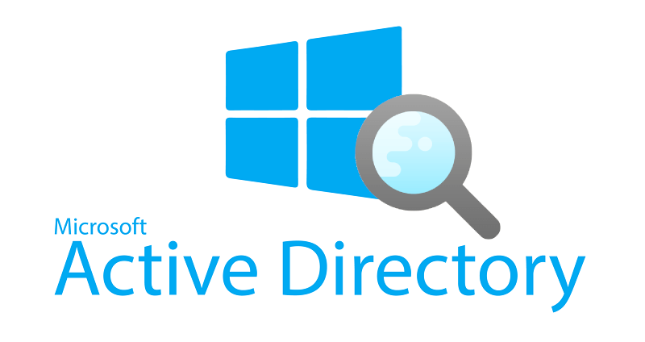
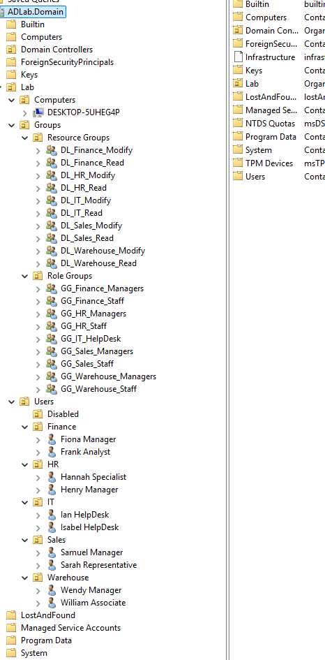
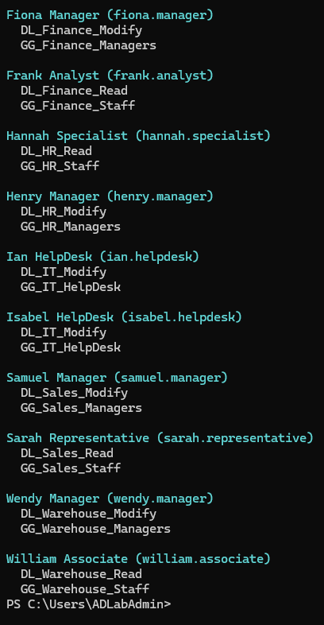
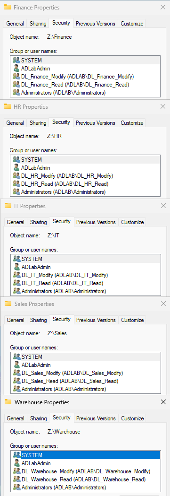
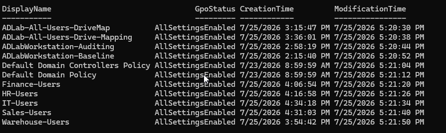

# Windows Server Active Directory Lab

A two-VM enterprise-style environment built to demonstrate Active Directory Domain Services, organizational unit design, role-based access control, detailed Group Policy administration, departmental SMB storage, NTFS permissions, and repeatable infrastructure validation.



## Contents

- [Project Details](#project-details)
- [Overview](#overview)
- [What Was Built](#what-was-built)
- [Identity and Organizational Unit Design](#identity-and-organizational-unit-design)
- [Role-Based Access Control and File Permissions](#role-based-access-control-and-file-permissions)
- [Group Policy Architecture](#group-policy-architecture)
- [Department User Policies](#department-user-policies)
- [PowerShell Validation](#powershell-validation)
- [Validation Scenarios](#validation-scenarios)
- [Result](#result)
- [Future Improvements](#future-improvements)

## Project Details

| Detail | Description |
| --- | --- |
| Role | Systems Administrator / Lab Designer |
| Tools | Windows Server, Windows 11, AD DS, DNS, GPMC, SMB, NTFS, RSAT, PowerShell |
| Timeline | July 2026 · Self-directed two-VM lab |

## Overview

The environment uses one Windows Server virtual machine as the domain controller, DNS server, Group Policy management point, and departmental file server. A Windows workstation is joined to the domain and provides a universal sign-in endpoint for Finance, HR, IT, Sales, and Warehouse users.

User access is determined through a combination of organizational-unit placement, Global role groups, Domain Local resource groups, Group Policy scope, SMB sharing, Access-Based Enumeration, and NTFS access control lists. This allows the same workstation and mapped drive to present different resources and settings to different departmental users.

## What Was Built

- A Windows Server domain providing Active Directory Domain Services, DNS, Group Policy, and SMB file services.
- A domain-joined Windows workstation capable of loading the correct user policies and resources for all five departments.
- An OU hierarchy separating computers, role groups, resource groups, departmental users, and disabled accounts.
- An AGDLP-style RBAC model using Global groups for job roles and Domain Local groups for resource permissions.
- A shared departmental drive backed by Access-Based Enumeration and least-privilege NTFS permissions.
- Computer and user GPOs for security baselines, auditing, mapped drives, screen locks, and department-specific shortcuts.
- PowerShell reports used to verify users, group nesting, Group Policy objects, and delegated file access.

## Identity and Organizational Unit Design

The domain is organized beneath a dedicated Lab OU. Computer objects are separated from users, while security groups are divided into Role Groups and Resource Groups. Departmental OUs contain Finance, HR, IT, Sales, and Warehouse accounts, and a Disabled OU provides a controlled location for inactive identities.



*Active Directory structure showing departmental OUs, computer placement, and separated role and resource groups.*

## Role-Based Access Control and File Permissions

User accounts are placed into Global security groups that represent department and role. Those Global groups are nested into Domain Local groups that represent a permission on a specific resource. NTFS permissions are assigned to the Domain Local groups rather than to individual users.

Department staff receive Modify or Read access according to their role. The model also supports controlled cross-department access. For example, Sales can be granted Read access to Warehouse inventory reports while Warehouse staff retain Modify access to the source files.



*Representative user-to-group assignments for Finance, HR, Sales, and Warehouse roles.*



*Department folders secured with separate Read and Modify Domain Local groups.*

## Group Policy Architecture

Group Policy was separated by purpose. Computer policies are linked to the Lab computer OU, while user policies are linked to the relevant departmental OU. This keeps security, auditing, drive mapping, and department personalization independently testable.



*Group Policy inventory covering domain, workstation, drive-mapping, and departmental policies.*

### ADLab-All-Users-DriveMap

Maps the departmental SMB share to **Z:** for users within the Lab user hierarchy.

| Setting | Value |
| --- | --- |
| Policy path | User Configuration → Preferences → Windows Settings → Drive Maps |
| Action | Update |
| Location | `\\<domain-controller>\Departments$` |
| Drive letter | Z: |
| Label | Department Files |
| Options | Reconnect enabled; remove the mapping when the preference item no longer applies |

The mapped drive exposes the root containing Finance, HR, IT, Sales, and Warehouse. Access-Based Enumeration and NTFS permissions determine which folders are visible and whether the user receives Read or Modify access.

### ADLab-All-Users-Drive-Mapping

A second drive-mapping object was retained during lab validation to compare policy processing and troubleshoot mapping behavior. The final production-style configuration should retain one authoritative Z: mapping to avoid duplicate preference processing.

### ADLabWorkstation-Baseline

Applies the baseline security configuration to the domain workstation.

| Setting | Configured value |
| --- | --- |
| Interactive logon: Do not display last signed-in user | Enabled |
| Interactive logon: Machine inactivity limit | 900 seconds |
| Interactive logon message title | ADLab Authorized Access |
| Interactive logon message text | Authorized-use and activity-monitoring notice |
| Accounts: Guest account status | Disabled |
| UAC: Run administrators in Admin Approval Mode | Enabled |
| UAC: Switch to the secure desktop when prompting | Enabled |
| Microsoft Defender Antivirus | Real-time protection, behavior monitoring, downloaded-file scanning, and program-activity monitoring enabled |
| Windows Defender Firewall | Domain, Private, and Public profiles enabled; inbound blocked and outbound allowed by default |
| Firewall logging | Dropped-packet logging enabled with a 16,384 KB log size |
| Automatic Updates | Automatic download and scheduled installation configured |

### ADLabWorkstation-Auditing

Enables detailed workstation event collection for authentication, account activity, resource access, and process troubleshooting.

| Audit category | Configured events |
| --- | --- |
| Advanced audit policy override | Enabled so subcategory settings override legacy audit categories |
| Logon and Logoff | Logon success/failure, logoff success, account lockout failure, special logon success |
| Account Management | User-account, security-group, and computer-account management success/failure |
| Detailed Tracking | Process creation success with command-line data included in process events |
| Object Access | File-share success/failure, detailed file-share failure, and removable-storage success/failure |
| PowerShell logging | Script Block Logging enabled; Module Logging enabled for all modules |

### Default Domain Policy

Reserved for domain-wide password and account-lockout controls.

| Setting | Value |
| --- | --- |
| Password history | 10 passwords remembered |
| Maximum password age | 90 days |
| Minimum password age | 1 day |
| Minimum password length | 12 characters |
| Complexity requirements | Enabled |
| Reversible encryption | Disabled |
| Account lockout threshold | 5 invalid sign-in attempts |
| Lockout duration | 15 minutes |
| Reset lockout counter | 15 minutes |

### Default Domain Controllers Policy

The default domain-controller policy remains linked to the Domain Controllers OU for controller-specific security assignments and is kept separate from workstation and departmental configuration.

## Department User Policies

Each department receives a user policy linked to its OU. Group Policy Preferences create desktop shortcuts, while user-side Personalization policies enforce department-appropriate inactivity controls. Manager-only resources are targeted through the appropriate manager Global group and remain protected by NTFS permissions.

### Finance-Users

- Creates **Finance Files** pointing to `Z:\Finance`.
- Creates **Financial Reports** pointing to `Z:\Finance\Financial Reports`.
- Creates a Finance Management shortcut targeted to `GG_Finance_Managers`.
- Enables the screen saver, requires a password on resume, sets a 300-second timeout, and prevents users from changing the screen saver.

### HR-Users

- Creates **HR Files** pointing to `Z:\HR`.
- Creates **Employee Records** pointing to `Z:\HR\Employee Records`.
- Creates an HR Management shortcut targeted to `GG_HR_Managers`.
- Enables the screen saver, requires a password on resume, sets a 300-second timeout, and prevents users from changing the screen saver.

### Sales-Users

- Creates **Sales Files** pointing to `Z:\Sales`.
- Creates **Customer Quotes** pointing to `Z:\Sales\Quotes`.
- Creates **Warehouse Inventory – Read Only** pointing to `Z:\Warehouse\Inventory Reports`.
- Creates a Sales Management shortcut targeted to `GG_Sales_Managers`.
- Enables the screen saver, requires a password on resume, and sets a 900-second timeout.

### Warehouse-Users

- Creates **Warehouse Files** pointing to `Z:\Warehouse`.
- Creates **Inventory Reports** pointing to `Z:\Warehouse\Inventory Reports`.
- Creates a Warehouse Management shortcut targeted to `GG_Warehouse_Managers`.
- Enables the screen saver, requires a password on resume, and sets a 900-second timeout.

### IT-Users

- Creates shortcuts to `Z:\IT\Documentation`, `Z:\IT\Scripts`, and `Z:\IT\Software`.
- Creates administrative-tool shortcuts for Active Directory Users and Computers, Group Policy Management, Event Viewer, and Computer Management.
- Provides centralized access to documentation, scripts, and software without changing the account's underlying administrative permissions.

## PowerShell Validation

PowerShell was used to inventory the environment and verify the configuration independently of the graphical consoles. Reports were generated for organizational units, user membership, role and resource groups, Group Policy objects, SMB shares, mapped drives, and NTFS access control lists.

```powershell
Get-ADOrganizationalUnit
Get-ADUser
Get-ADGroup
Get-ADGroupMember
Get-ADPrincipalGroupMembership
```

```powershell
Get-GPO -All
gpresult /h
Get-SmbShare
Get-SmbMapping
Get-Acl
```

## Validation Scenarios

- Verified that the domain workstation receives computer baseline and auditing policies after the computer object is placed in the Lab computer OU.
- Confirmed that users receive the shared Z: drive and the correct department shortcuts after signing into the same workstation.
- Validated that Finance, HR, IT, Sales, and Warehouse accounts receive access through role-group and resource-group nesting rather than direct user permissions.
- Confirmed that Sales can read Warehouse inventory reports but cannot create, edit, or delete files in the protected folder.
- Verified that manager-only shortcuts appear through item-level targeting and that NTFS permissions remain the authoritative access control.
- Reviewed applied user and computer policy through Group Policy Results and generated HTML reports with `gpresult /h`.

## Result

The completed lab provides a compact representation of a departmental Windows domain. One workstation can serve users from five departments while applying different shortcuts, screen-lock controls, and resource permissions according to the signed-in identity.

The project demonstrates practical experience with AD DS, DNS, OU design, AGDLP-style security-group nesting, Group Policy processing, SMB shares, Access-Based Enumeration, NTFS permissions, RSAT, and PowerShell-based configuration validation.

## Future Improvements

Checked items are included in this repository; unchecked items are planned additions.

- [x] Add screenshots of OU structure, security groups, file permissions, and GPOs.
- [ ] Publish reusable PowerShell inventory and validation scripts.
- [ ] Add a build guide covering VM setup, domain creation, and workstation enrollment.
- [ ] Include a department-by-department access test matrix and sample results.
- [ ] Consolidate the duplicate drive-mapping policies and document the final configuration.
- [ ] Add troubleshooting notes and lessons learned.
